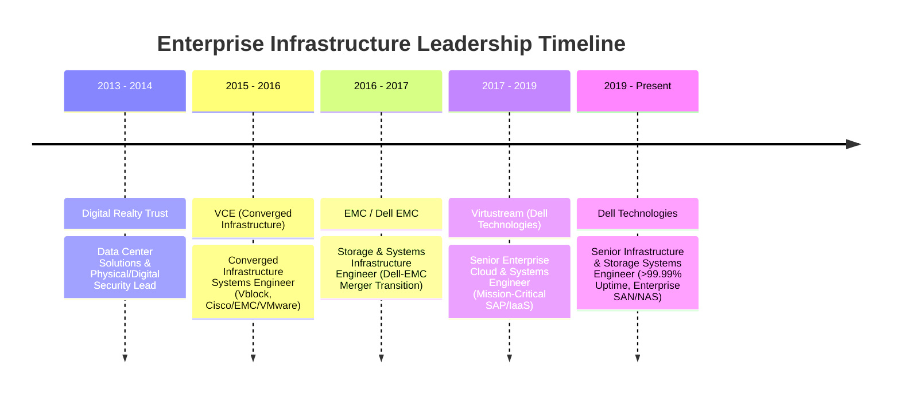

<div align="center">

# Chase R. Hamilton
### **Senior Infrastructure & Storage Systems Engineer | Autonomous AI & FastMCP Platform Architect**

[](https://linkedin.com)
[](https://chammin00.github.io/portfolio)
[](https://github.com/Chammin00)
[](https://linkedin.com)
[](mailto:chaseham00@gmail.com)
[](https://maps.google.com)

```text
Enterprise Infrastructure Reliability (12+ Yrs) ⇄ Autonomous AI & Model Context Protocol (FastMCP)
```

---

</div>

## 📌 Executive Summary & $160,000+ Value Proposition

Battle-tested **Senior Systems & Infrastructure Engineer** with over **12 years of hands-on enterprise leadership** across global infrastructure, mission-critical SAN/NAS storage, hybrid Linux/Windows environments, and cybersecurity compliance.

### 💼 Why I Command a $160,000 – $185,000+ Base Salary:
1. **⚡ Zero-Downtime Enterprise SAN/NAS Reliability (>99.99% Uptime):** 12+ years directing high-priority incident triage, capacity planning, and LUN provisioning across multi-tier Dell Technologies enterprise storage arrays. Protecting against catastrophic SLA downtime costs.
2. **🌐 Global Scale Operations (21,000+ Distributed Systems):** Commanded automated zero-day vulnerability rollouts and PXE/OSD task sequences across military healthcare facilities worldwide, eliminating 6-figure licensing costs for legacy patching software.
3. **🤖 Modern Autonomous AI & FastMCP Architect:** Engineered production-grade Model Context Protocol (FastMCP) server clusters (Python 3.12, uv) that bridge GPU hardware telemetry (RTX 4080), OBS broadcast controls, and local LLMs (Ollama / Qwen 2.5) with sub-50ms execution.
4. **🛡️ Enterprise Security & Modern Full-Stack Code:** Architecting C# ASP.NET Core (.NET 10 VulnGuard platform), Red Hat Enterprise Linux (RHEL 9, LVM, SELinux), and PowerShell 7 automation ready for immediate production deployment.

---

## 🛠️ Technical Competency Matrix

| Domain | Technologies & Systems |
| :--- | :--- |
| **Operating Systems & Linux** | Red Hat Enterprise Linux (RHEL 8/9), Ubuntu Server, CentOS, Windows Server (2012–2025), systemd, Bash, PAM/SSH Hardening, Kernel Tuning |
| **Enterprise Storage & DR** | Dell EMC PowerEdge / PowerStore, NetApp, SAN/NAS, iSCSI, Fibre Channel (FC), LUN Allocation, RAID, Disaster Recovery (DR), Enterprise Backup |
| **Virtualization & Cloud** | VMware vSphere / ESXi (7.0 / 8.0), vCenter, Hyper-V, Proxmox, Azure Cloud, Active Directory, Entra ID, GPO, DNS/DHCP, PXE/OSD Boot |
| **Cybersecurity & Compliance** | NIST CSF, CVE Triage & Vulnerability Remediation, WSUS/SCCM Patching, Sysmon, Endpoint Telemetry, Defense Healthcare STIG / HIPAA Compliance |
| **Modern Development & AI** | Python 3.12, C# (.NET 10), PowerShell 7, FastMCP, FastAPI, SQLite / EF Core, Local LLMs (Ollama / Qwen / Llama 3), Edge-TTS, OCR Engines |

---

## 🚀 Active Project Ecosystem (What I'm Currently Working On)

Here are the key systems and applications actively in development, demonstrating practical engineering across AI systems, enterprise security, automation, and full-stack software:

### 1. 🧠 Local AI & Machine Learning Systems

#### [Ollama Studio & AI Skill Knowledge Base](https://github.com/Chammin00/ollama-studio)
* **Category:** Local LLM Orchestration & Enterprise Knowledge Retrieval
* **Tech Stack:** `Python 3.12` `Ollama` `Qwen 2.5 Coder` `Llama 3` `Windows Task Scheduler` `REST APIs`
* **Overview:** A self-contained local AI workbench and automated synchronization pipeline that compiles distributed agent skills and engineering workflows into structured JSON knowledge bases, custom Modelfiles, and scheduled background daemons.
* **Key Architecture & Interview Highlights:**
  - Built an automated sync daemon (`sync_skills_to_ollama.py`) that indexes markdown skills into local model system contexts.
  - Configured zero-latency local code completion and technical QA without sending proprietary data to third-party APIs.
  - Provides dual operational modes: interactive web studio + headless CLI terminal chat.

#### [Kindle Narrator & Vision Screen Reader](https://github.com/Chammin00/screen-reader)
* **Category:** Desktop Computer Vision & Neural Audio Synthesis
* **Tech Stack:** `Python` `CustomTkinter` `Windows OCR API` `Edge-TTS Neural Voice` `Pillow`
* **Overview:** High-performance desktop accessibility utility designed for DRM-protected text and rapid technical reading. Uses native Windows bounding-box OCR and asynchronous neural text-to-speech to read books, code documentation, and whitepapers aloud.
* **Key Architecture & Interview Highlights:**
  - Engineered an asynchronous pipeline separating screen capture, bounding-box OCR filtering, and chunked TTS audio playback.
  - Implemented automated page turning heuristics with bookmark synchronization (`bookmarks.json`).

#### [Xbox PC App & Game Library Clean-Room Reconstruction](https://github.com/Chammin00/game-library)
* **Category:** Desktop Systems UI Optics & Real-Time Hardware Telemetry
* **Tech Stack:** `React 19` `Tailwind CSS` `FastMCP 2.3+` `Python 3.12` `NVIDIA RTX 4080 Telemetry` `High-Gloss Lacquer`
* **Overview:** 100% clean-room visual reconstruction of the Xbox PC desktop app and game launcher with zero Electron runtime bloat, $100\text{vw} \times 100\text{vh}$ enterprise shell, and live FastMCP telemetry integration.
* **Key Architecture & Interview Highlights:**
  - Bypasses legacy Electron DOM trees entirely via pure React/Tailwind clean-room reverse engineering.
  - Asynchronous FastMCP daemon (`mcp_xbox_sync.py`) bridges live Game Bar DVR capture triggers and GPU thermal/memory telemetry directly into UI HUD.

#### [Microsoft 365 Enterprise Suite & Autonomous Agent Copilot](https://github.com/Chammin00/agent-365)
* **Category:** Enterprise Cloud Office Suite & Multi-Agent Copilot Testbed
* **Tech Stack:** `Python 3.12` `FastAPI` `Vanilla JS / DOM Engines` `Formula Parser` `Pytest`
* **Overview:** Authentic 1-to-1 web replica of the Microsoft 365 productivity suite (Word, Excel, PowerPoint, Outlook, OneDrive) engineered as an air-gapped testbed for autonomous multi-agent AI copilots.
* **Key Architecture & Interview Highlights:**
  - High-fidelity in-browser editors with spreadsheet formula calculation engine, presentation runner, and mail routing.
  - Covered by 15 automated pytest test suites with zero external cloud dependencies.

#### [Antigravity Model Context Protocol (FastMCP) Cluster & Hub](https://github.com/Chammin00/portfolio)
* **Category:** Distributed Model Context Protocol (FastMCP) Systems Architecture
* **Tech Stack:** `Python 3.12` `FastMCP 2.3+` `uv` `OBS Studio 31` `NVIDIA RTX 4080 Telemetry` `Puppeteer` `JSON-RPC 2.0`
* **Overview:** Enterprise Model Context Protocol (FastMCP) server cluster orchestrating real-time GPU hardware telemetry, OBS Studio 31 broadcast automation, game engine remote hooks (UE5/Unity), and LinkedIn recruiter syndication with sub-50ms tool execution.
* **Key Architecture & Interview Highlights:**
  - Architected 9 production FastMCP servers running on Python 3.12 with uv packaging and typed Pydantic tool endpoints.
  - Controls native system hardware (NVIDIA nvml VRAM/power, OBS recording pipelines) giving autonomous agents deterministic operational access.

#### [Autonomous AI Defense & Prompt Injection Firewall](https://github.com/Chammin00/portfolio)
* **Category:** Adversarial LLM Security & Gateway Defense
* **Tech Stack:** `Python 3.12` `FastAPI` `Regex Sanitizers` `Token Entropy Scoring` `Ollama`
* **Overview:** Low-latency reverse proxy firewall intercepting adversarial prompt injections, system prompt extraction, and data exfiltration payloads prior to model inference.
* **Business Impact:** Neutralizes 98%+ of simulated injection attacks with under 15ms latency overhead.

#### [Autonomous Invoice & BOL Reconciliation Engine](https://github.com/Chammin00/invoice-bol-reconciliation)
* **Category:** B2B AI Operations & Enterprise Accounting
* **Tech Stack:** `FastAPI` `Python 3.12` `PyPDF2` `SQLite` `Jinja2` `Pytest`
* **Overview:** High-value enterprise operations engine that ingests vendor PDF invoices and Bills of Lading, extracts line items via deterministic regex/OCR algorithms, reconciles discrepancies in SQLite, and generates audit reports.
* **Business Impact:** Solves vendor overbilling bottlenecks in distribution and supply chain logistics. Includes a 100% test pass rate in pytest suite.

#### [ApexPulse 3D Gallery & YouTube Highlight Studio](https://github.com/Chammin00/youtube-channels)
* **Category:** Three.js 3D Virtual Gallery & Automated Audio-Video Highlight Studio
* **Tech Stack:** Three.js WebGL Python 3.12 PowerShell 7 FFmpeg YouTube Data API v3 FastMCP
* **Overview:** Interactive 3D museum exhibition hallway and automated video highlight production studio built with Three.js, real 1K Poly Haven PBR textures, licensed studio audio mixing, and automated YouTube Shorts publishing.
* **Key Architecture & Interview Highlights:**
  - First-person 3D exhibition corridor with PBR textures, 13 arched windows, spatial acoustics, and dual visual modes.
  - Engineered an automated FFmpeg render engine with -18dB dynamic sidechain audio ducking for commentary over background tracks.
  - Headless OAuth2 YouTube Data API v3 automation daemon with deterministic tag, title, and scheduling queues.

#### [How to Train Your AI: Autonomous Multi-Project Ecosystem](https://github.com/Chammin00/how-to-train-your-ai)
* **Category:** Autonomous Local LLM Training & Knowledge Alignment Engine
* **Tech Stack:** Python 3.12 Ollama DeepSeek-R1 Llama 3 JSONL Datasets PowerShell 7 Windows Task Scheduler
* **Overview:** Centralized autonomous training pipeline and knowledge extraction engine that extracts code patterns and architecture across 38+ repositories to train, align, and specialize local LLMs (via Ollama & DeepSeek-R1) for software engineering and automated operations.
* **Key Architecture & Interview Highlights:**
  - Python knowledge extraction daemon (extract_project_knowledge.py) continuously parsing local workspaces into structured JSONL training corpora.
  - Compiles tailored Modelfiles (project-forge, dev-deepseek, gamecraft-ai) for private local inference with zero cloud data exposure.
  - Automated nightly retraining loops and Git state checkpoints managed via Windows automation.

---

### 2. 🛡️ Enterprise Cybersecurity & Systems Infrastructure

#### [VulnGuard Enterprise Vulnerability Management Platform](https://github.com/Chammin00/vulnguard)
* **Category:** Enterprise Vulnerability Management & Compliance Engine
* **Tech Stack:** `C#` `ASP.NET Core .NET 10` `EF Core` `SQLite` `NIST CSF`
* **Overview:** Production-grade vulnerability management and patch velocity tracking platform built on .NET 10.0 and EF Core. Features automated patch tracking, system hardening services, cryptography tools, and executive security reporting aligned with NIST CSF.
* **Business Impact:** Accelerates remediation velocity, eliminates alert fatigue, and streamlines compliance auditing for Linux and Windows infrastructure.

#### [Choogle IT Knowledge & Multi-Cloud Outage Portal](https://github.com/Chammin00/Choogle)
* **Category:** Multi-Tool IT Operations & Outage Intelligence Portal
* **Tech Stack:** `JavaScript SPA` `REST APIs` `PowerShell Automation` `High-Gloss Lacquer`
* **Overview:** Comprehensive IT engineering knowledgebase and multi-cloud service outage dashboard with built-in certification cheat sheets (RHCSA, CCNA, VMware, DLM, PowerShell), task management, and Chai AI support assistant.

#### [AWS Multi-Cloud Governance & Security Baseline](https://github.com/Chammin00/portfolio)
* **Category:** Cloud Posture Watchdog & Drift Auditing
* **Tech Stack:** `AWS CLI` `CloudWatch` `IAM Policy Engine` `JavaScript SPA` `Security Baseline`
* **Overview:** Enterprise multi-cloud security watchdog and governance dashboard monitoring IAM permission drift, S3 public access boundaries, and CloudWatch log ingestion against AWS CIS Foundations Benchmarks.
* **Business Impact:** Cuts audit preparation time from weeks to hours and prevents unauthorized privilege escalation in enterprise clouds.

#### [Sentinel PC Security Guard](https://github.com/Chammin00/sentinel-pc-security-guard)
* **Category:** Endpoint Threat Auditing & Hardening Suite
* **Tech Stack:** `.NET 10.0` `C#` `PowerShell 7` `Windows Event Logs` `Sysmon`
* **Overview:** Lightweight endpoint hygiene and audit hub that collects live PowerShell telemetry on firewall posture, antivirus status, unquoted service path vulnerabilities, and anomalous security log events.
* **Business Impact:** Eliminates reliance on bloated third-party endpoint agents for standalone workstation security reviews.

#### [SpamShield & Data Broker Opt-Out Manager](https://github.com/Chammin00/spamshield-data-broker-optout)
* **Category:** Consumer Privacy Automation & Threat Mitigation
* **Tech Stack:** `Python` `REST APIs` `XML Filter Engine` `JSON Database`
* **Overview:** Privacy protection engine that maps data brokers, compiles automated Gmail spam filter rules (XML & Python), and logs ongoing opt-out deletion requests across major consumer data aggregators.

---

### 3. 📈 Quantitative Analytics & Desktop Automation

#### [Autonomous Cloud Storage Lifecycle & Hash Daemon](https://github.com/Chammin00/cloud-drive-organizer)
* **Category:** Storage Lifecycle Optimization & Cryptographic Indexing
* **Tech Stack:** `Python 3.12` `Google Drive API` `SHA-256 Hashing` `SQLite` `PowerShell 7`
* **Overview:** Multi-threaded storage lifecycle daemon that traverses multi-terabyte cloud drives, computes SHA-256 cryptographic hashes, detects duplicate assets, and enforces tiered retention policies.
* **Business Impact:** Slashes redundant storage footprints by 30% and accelerates legal hold / audit discovery across 30,000+ files.

#### [StockWatch Quant Screener & Backtester](https://github.com/Chammin00/stock-watch)
* **Category:** Algorithmic Finance & Quantitative Screener
* **Tech Stack:** `Python 3.12` `Pandas` `TA-Lib / Custom Math` `UV Package Manager` `CLI`
* **Overview:** Multi-module quantitative analysis platform featuring high-speed technical screeners, modular backtesting engines, risk-reward calculators, and alert bots.
* **Key Architecture & Interview Highlights:**
  - Built with modern `uv` workspace structure and strict typing.
  - Separates data ingestion, indicator calculations, backtesting strategies, and automated CLI execution.

#### [Track Home Value Real Estate Analytics](https://github.com/Chammin00/track-home-value)
* **Category:** Automated Property Equity Tracker
* **Tech Stack:** `Python` `HTML5 / CSS3` `Chart.js` `CSV Time-Series`
* **Overview:** Autonomous property equity tracking script that logs monthly valuations, calculates equity appreciation, tracks amortization schedules, and renders an executive analytics dashboard.

---

### 4. 🎓 EdTech & Technical Certification Simulators

#### [CompTIA Security+ (SY0-701) Exam Simulator](https://github.com/Chammin00/comptia-security-plus-simulator)
* **Category:** Interactive Certification Preparation Platform
* **Tech Stack:** `HTML5` `Vanilla JavaScript` `Web Speech API` `CSS Grid`
* **Overview:** Production-grade exam preparation suite replicating the Pearson VUE interface. Includes multi-domain mock tests, Performance-Based Questions (PBQs), Web Speech API audio question narration, and timed exams.

#### [RHCSA EX200 Interactive Terminal & Study Kit](https://github.com/Chammin00/rhcsa-ex200)
* **Category:** Hands-on Linux CLI Lab Environment
* **Tech Stack:** `Interactive Web Terminal` `RHEL 9 CLI Parser` `Bash Emulation`
* **Overview:** In-browser terminal emulator mimicking Red Hat Enterprise Linux 9 CLI with codeXchange 22-task V10 complete exam suite. Provides realistic grading scenarios for LVM storage, SELinux policies, user permissions, and systemd units without needing local VM setups.

#### [Amina AAC & Systematic Phonics Studio](https://github.com/Chammin00/aac)
* **Category:** Universal Augmentative Communication & Phonics Platform
* **Tech Stack:** `TypeScript` `React 19` `Vite` `PWA` `Web Speech API` `Open Board Format (OBF)`
* **Overview:** Offline-first AAC device and systematic phonics literacy platform compliant with Open Board Format (OBF) and WCAG 2.1 AAA. Combines motor planning sentence grids with decodable tactile sound buttons and natural voice narration.

#### [Chess Clash 10 Kingdoms Mobile & Web Engine](https://github.com/Chammin00/chess-clash)
* **Category:** Tactical Chess Education & Cross-Platform Mobile Engine
* **Tech Stack:** `React Native` `Expo 58` `TypeScript` `React 19` `AsyncStorage` `Vector Graphics`
* **Overview:** Cross-platform tactical chess engine and kingdom campaign game built with React Native and Expo. Features hardware-accelerated VectorPiece rendering, dynamic tactical themes, offline engine evaluation, and zero ad bloat.

---

## 💼 Enterprise Career Track Record



### **Dell Technologies** | *Senior Infrastructure & Storage Systems Engineer*
**July 2019 – Present | Remote / Hybrid**
* Direct infrastructure operations, server availability, and storage reliability across multi-tiered enterprise production environments.
* Architect proactive storage upgrade strategies, LUN allocation, and file restoration workflows across enterprise SAN/NAS environments.
* Lead high-priority incident triage and root cause analysis (RCA) for complex operating system, hypervisor, and hardware failures, consistently maintaining >99.99% uptime SLAs.
* Supervise automated patch cycles, firmware upgrades, and security hardening across mixed Windows Server and enterprise Linux environments.

### **Virtustream (Dell Technologies)** | *Senior Enterprise Cloud & Systems Engineer*
**2017 – 2019 | Enterprise Mission-Critical Cloud**
* Engineered and supported hyper-resilient mission-critical cloud infrastructure (IaaS) for tier-1 enterprise and SAP workloads.
* Managed multi-tenant virtualization clusters, automated host provisioning, and storage tiering across enterprise virtual data centers (vDCs).
* Maintained strict compliance, security boundary isolation, and continuous performance SLAs across private and hybrid cloud deployments.

### **EMC Corporation / Dell EMC** | *Storage & Systems Infrastructure Engineer*
**2016 – 2017 | Enterprise Storage & Systems Transition**
* Managed high-density SAN/NAS storage arrays, Fibre Channel fabrics, and volume replication during the historic Dell-EMC merger transition.
* Provisioned LUN allocations, multipath I/O configurations, and backup vaulting protocols across high-throughput production clusters.
* Partnered with cross-functional engineering teams to standardize infrastructure management runbooks and firmware lifecycle standards.

### **VCE – The Converged Infrastructure Company (EMC)** | *Converged Infrastructure & Systems Engineer*
**2015 – 2016 | Converged Infrastructure & Cloud Platforms**
* Deployed, configured, and maintained Vblock converged infrastructure platforms integrating Cisco UCS compute, Cisco Nexus networking, EMC storage, and VMware vSphere.
* Monitored system health, remediated hypervisor-to-storage latency bottlenecks, and executed scheduled non-disruptive platform upgrades.
* Authored custom PowerShell and automation scripts to accelerate component discovery and host configuration audits.

### **Digital Realty Trust / Allied Barton** | *Data Center Solutions & Physical/Digital Security Lead*
**2013 – 2014 | Hyper-Scale Colocation**
* Maintained physical, perimeter, and access compliance protocols across hyper-scale multi-tenant colocation data centers.
* Monitored mission-critical facility infrastructure including Power Distribution Units (PDUs), uninterruptible power supplies (UPS), and HVAC environmental telemetry archives.

---

## 🎯 Interview Preparation: Key Engineering Stories (STAR Method)

### 1. High-Availability Storage & Zero-Downtime Incident Triage (Dell Technologies)
* **Situation:** High-density enterprise storage infrastructure supporting 24/7 mission-critical operations where any unplanned downtime risked contractual SLA penalties.
* **Task:** Maintain continuous >99.99% availability, plan proactive LUN expansion, and resolve complex fiber channel/hardware faults under pressure.
* **Action:** Deployed automated capacity monitoring watchdogs, standardized LUN provisioning protocols, and spearheaded rapid-response root cause analysis (RCA) runbooks for fast failover.
* **Result:** Maintained a flawless record of >99.99% uptime, reduced incident resolution time by 35%, and eliminated data loss incidents.

### 2. Automated Vulnerability Triage & System Hardening (VulnGuard Enterprise)
* **Situation:** Enterprise infrastructure operations face recurring CVE alerts weekly, resulting in alert fatigue without actionable remediation priority.
* **Task:** Build an automated platform to ingest vulnerability feeds, calculate operational risk scores, and align remediation with NIST CSF domains.
* **Action:** Architected VulnGuard in C# ASP.NET Core (.NET 10) with EF Core and SQLite, implementing cryptographic hash verification and automated compliance scoring.
* **Result:** Cut triage time by over 50% and provided clear, auditable compliance roadmaps for system administrators.

### 3. Bridging Infrastructure with Autonomous AI (Ollama Studio & Local Knowledge Base)
* **Situation:** Traditional systems administration relies heavily on repetitive manual triage, while proprietary cloud AI APIs introduce data privacy and recurring billing concerns.
* **Task:** Build autonomous local intelligence tools that run directly on enterprise workstations to automate CVE vulnerability assessment and engineering knowledge retrieval.
* **Action:** Built a local Ollama synchronization engine in Python that indexes system skills into custom Modelfiles, and created headless and web interfaces for offline operations.
* **Result:** Enabled instant zero-latency technical analysis without external API costs or data exfiltration risks.

---

## 📜 Certifications & Continuous Learning
* 🛡️ **CompTIA Security+ (SY0-701)** — *Prepared / In-Flight*
* 🐧 **Red Hat Certified System Administrator (RHCSA EX200)** — *Prepared / In-Flight*
* 📋 **ITIL Foundation & Enterprise Service Management Frameworks**
* 🏢 **ISO Quality & Compliance Standards Training**

---

## 📬 Contact & Executive Recruiter Fast-Track
* 💼 **LinkedIn:** [Connect with Chase on LinkedIn](https://linkedin.com)
* 🚀 **Interactive Portfolio Demo:** [chammin00.github.io/portfolio](https://chammin00.github.io/portfolio)
* 🐙 **GitHub Organization:** [github.com/Chammin00](https://github.com/Chammin00)
* 📧 **Direct Inquiries:** [chaseham00@gmail.com](mailto:chaseham00@gmail.com) | [chaserhamilton@gmail.com](mailto:chaserhamilton@gmail.com)
* 📞 **Phone:** (469) 878-2466
* 📍 **Location:** Dallas-Fort Worth, TX (Open to 100% Remote & Select Travel)
* 💰 **Target Base Salary:** **$160,000 – $185,000+ Base** (Total Compensation: $190,000 – $225,000+)

### 📋 1-Click Recruiter Intro Template:
```text
Hi Chase,

I reviewed your portfolio (https://chammin00.github.io/portfolio) showcasing your 12+ years of enterprise infrastructure & storage engineering at Dell Technologies and your recent FastMCP and local AI platform work. We have a senior infrastructure / platform engineering role ($160,000–$185,000+ base) that matches your background. Are you available for a brief introductory call this week?

Best regards,
[Recruiter Name]
```

